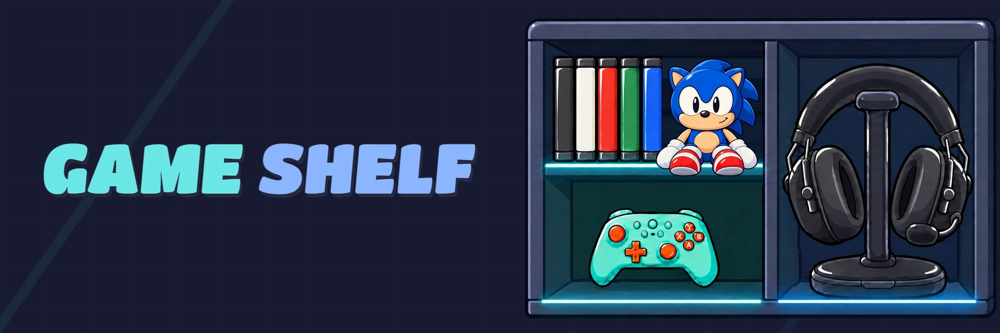

**Live:** [bytiagodev.github.io/game-shelf](https://bytiagodev.github.io/game-shelf/)

A little place to keep the games I've played, with a case for each game and notes to remind me what I thought of it at the time.

Game Shelf is my Steam journal, kept by hand from 2026 onwards. Open a case and there is the cover, whether I finished it, lifetime playtime, when I last played and whatever I wrote about it. A game I come back to in a new year sits on both years' shelves and keeps its earlier notes, so I can see whether I changed my mind. The cabinet grows another row whenever the collection does.

The shelves are part of it too. The controller, headset and Sonic plush sitting among the cases are drawn after my own: the mint 8BitDo Ultimate 2C and Razer BlackShark V3 I play with, and a rather chunky Sonic from my real shelves.

## What it does

- One case per game, with 20 sleeve colours and a cover inside.
- A shelf for each year; a game I return to in a new year appears on both.
- A status for each game, with a small sticker on cases I'm still playing or dropped.
- Search, year and genre filters, plus sorting by title or last played.
- Dated notes that keep earlier impressions when I return to a game.
- Responsive shelves that keep every row balanced, and game details that work with a keyboard.

Built with React, Vite and plain CSS. Case titles are real text rather than part of the artwork. There is no Steam sync and no account: games are entered by hand, with dates and lifetime hours checked in Steam.

## Running it

Use Node 20.19+ or 22.12+.

```sh
npm ci
npm run dev
```

```sh
npm test
npm run build
npm run preview
```

`npm run build` creates the static site in `dist/`, with relative asset paths suitable for GitHub Pages.

Adding a game, covers and sleeve colours are covered in [docs/adding-games.md](docs/adding-games.md).

## Artwork

The illustrations were generated with AI. The title uses [Titan One](https://fonts.google.com/specimen/Titan+One) by Rodrigo Fuenzalida, licensed under the SIL Open Font License (see `src/assets/fonts/`).

## Disclaimer

This is a personal, non-commercial project. Sonic the Hedgehog is a character and trademark of SEGA, and the Sonic plush illustration is fan art of my own toy. Game titles, cover art and Steam belong to their respective publishers and Valve, and the controller and headset designs to 8BitDo and Razer. Game Shelf is not affiliated with or endorsed by any of them.
