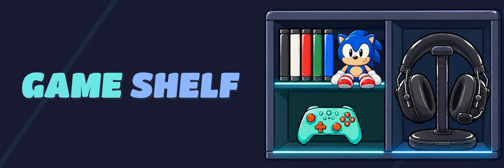

**Live:** [bytiagodev.github.io/game-shelf](https://bytiagodev.github.io/game-shelf/)

A little place to keep the games I've played, with a case for each game and notes to remind me what I thought of it at the time.

Game Shelf is my personal Steam journal. I add entries manually, starting with 2026, and open their cases to see a cover, whether I finished it, lifetime playtime, last-played date and dated notes. The illustrated cabinet grows into more rows as the collection grows.

## What it does

- One case per game, with 18 sleeve colours and a cover inside.
- A shelf for each year; a game I return to in a new year appears on both.
- A status for each game, with a small sticker on cases I'm still playing or dropped.
- Search, year and genre filters, plus sorting by title or last played.
- Dated notes that keep earlier impressions when I return to a game.
- Responsive shelves that keep every row balanced, and game details that work with a keyboard.

Built with **React, JavaScript, Vite and plain CSS**. Case titles are real text rather than part of the artwork. No automatic Steam sync, account system or backend.

Games are entered by hand with dates and lifetime hours checked in Steam.

## Run locally

Use Node 20.19+ or 22.12+.

```sh
npm ci
npm run dev
```

```sh
npm test
npm run build
npm run preview
```

`npm run build` creates the static site in `dist/`, with relative asset paths suitable for GitHub Pages.

## Add a game

Edit `src/data/games.js`. Each game is one object.

```js
export const games = [
  {
    id: 'your-game',
    title: 'Your game',
    steamAppId: null,
    genres: ['Adventure'],
    years: [2026],
    lastPlayed: { date: '2026-09-01', precision: 'month' },
    status: 'playing',
    totalHours: null,
    coverUrl: null,
    sleeve: 'mint',
    notes: [
      { date: '2026-10-04', text: 'A thought to keep for later.' },
    ],
  },
];
```

- `id` is a unique, stable identifier.
- `years` lists every year the game was played, from 2026 onwards. When returning to a game in a new year, add that year instead of creating a second case; the game then appears on each of those shelves. Years before the collection's start year are never shown.
- `lastPlayed` can be `null`, an exact date with `precision: 'day'`, or an approximate month with `precision: 'month'`. For a month, use its first day for sorting; the interface displays only the month and year.
- `status` is `'playing'`, `'finished'`, `'dropped'` or `null` when not recorded.
- `totalHours` is the lifetime total copied from Steam. Use `null` if unknown; zero remains zero. It does not represent hours played that year.
- `steamAppId` enables the Steam store link.
- `coverUrl` is optional: it's where the game's portrait cover is downloaded from. Leave it `null` and the cover is looked up on Steam from `steamAppId`. Run `npm run covers` after adding a game: it saves any missing cover to `src/assets/covers/<id>.jpg`, and the site shows that local copy, so covers keep working even if Steam changes its links. `npm run covers -- --force` downloads them all again. A missing cover shows a title fallback, and the tests fail until every game has one.
- For a game I own through a Steam collection, use the collection's app ID and cover. The title can be the single game or the whole collection; when it's the single game, the optional `steamCollection` field names the collection in the details panel.
- `sleeve` names one of the 18 illustrated case colours: `mint`, `yellow`, `blue`, `lavender`, `pink`, `orange`, `black`, `white`, `red`, `royal-blue`, `green`, `grey`, `teal`, `cream`, `brown`, `burgundy`, `lime` or `violet`. The spine title colour and the fallback cover follow it.
- Optional `spineTitle` provides a shorter case label. Both names are searchable; the full `title` stays in game details and accessible labels.
- Use `\n` inside `spineTitle` to choose a line break, for example `"Prince of Persia:\nThe Lost Crown"`. Other labels wrap automatically when needed.
- Use `notes: []` when there are no notes. When I return to a game, I keep its one case: append a dated note, update `lastPlayed`, `totalHours` and `status`, and add the year to `years` if it is a new one.
- Games can have several genres; the genre filter lists every genre on the selected year's shelf.

The `profile` object in the same file sets the collection's starting year.

Historical dates may be approximate or unknown. Lifetime Steam hours cannot reconstruct yearly hours or session counts. New entries and notes can be more precise as I record them.

## Artwork

The illustrations were generated with AI. The controller, headset and Sonic plush on the shelves are drawn after my own: the mint 8BitDo Ultimate 2C and Razer BlackShark V3 I play with, and a rather chunky Sonic plush from my shelves.

The title uses [Titan One](https://fonts.google.com/specimen/Titan+One) by Rodrigo Fuenzalida, licensed under the SIL Open Font License (see `src/assets/fonts/`).

## Disclaimer

This is a personal, non-commercial project. Sonic the Hedgehog is a character and trademark of SEGA, and the Sonic plush illustration is fan art of my own toy. Game titles, cover art and Steam belong to their respective publishers and Valve, and the controller and headset designs to 8BitDo and Razer. Game Shelf is not affiliated with or endorsed by any of them.
